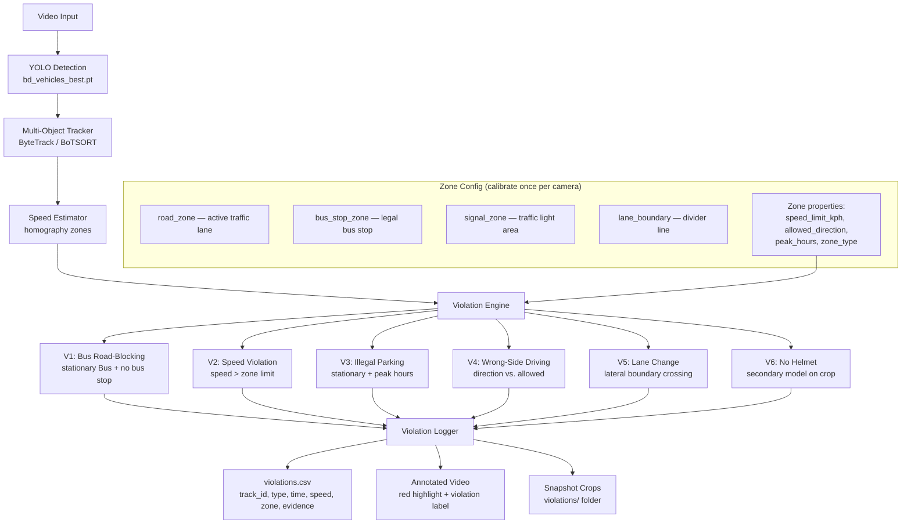

# Dhaka Traffic Violation Detection System — Architecture Plan

## 1. What You Already Have vs. What's Needed

Your current system provides three critical building blocks that most of the violations can be built **on top of**:

| Building Block | Source | What it gives you |
| :--- | :--- | :--- |
| **Per-frame detection** with BD vehicle classes | `bd_vehicles_best.pt` (16 classes) | Vehicle class (Bus, CNG, Motorbike…) + bounding box every frame |
| **Persistent multi-object tracking** | `vehicle_tracker.py` (ByteTrack/BoTSORT) | Stable `track_id` across frames, majority-voted class, frame count |
| **Ground-plane speed & position** | `speed_tracker.py` (homography zones) | Real-world speed (km/h), position in metres, direction of travel |

---

## 2. Violation-by-Violation Feasibility Analysis

### ✅ Tier 1 — Directly achievable with current model + tracking + zones

These violations only need **rule logic** on top of data you already compute.

#### V1: Bus Road-Blocking (stopping in active road without bus stop)
**What to detect**: A `Bus` track with speed ≈ 0 km/h for > T seconds (e.g. 8–15 s) inside an "active road zone" but NOT inside a marked "bus stop zone".

**How it works**:
1. During calibration, mark two zone types: `road_zone` (active traffic lane) and `bus_stop_zone`.
2. If a Bus track's smoothed speed drops below 3 km/h for more than `--bus-dwell-sec` (default 10 s) while inside a `road_zone` and NOT inside any `bus_stop_zone` → **VIOLATION**.
3. Exclude traffic signal stops: optionally mark `signal_zone` areas. If a cluster of 3+ vehicles are all near-stationary simultaneously in the same zone, suppress violations (it's a red light, not illegal stopping).

**Accuracy lever**: The red-light suppression heuristic. Without it, every bus at a red light is a false positive.

```
Inputs needed:   speed (have it), class (have it), zone type (new calibration)
New model:       NO
Accuracy:        HIGH (8/10) — main risk is red-light false positives, solvable with signal-zone or cluster heuristic
```

#### V2: Speed Violation
**What to detect**: Any vehicle exceeding a zone's speed limit.

**How it works**:
1. Add a `speed_limit_kph` field to each zone in `speed_zones.json`.
2. When `SpeedEstimator.current(tid)` exceeds the limit for ≥ N consecutive frames → **VIOLATION**.
3. Per-class limits (e.g., Bus max 40, Car max 60) are straightforward.

```
Inputs needed:   speed (have it), class (have it)
New model:       NO
Accuracy:        HIGH (9/10) — homography calibration quality is the main variable
```

#### V3: Illegal Parking on Active Road
**What to detect**: Any vehicle stationary for > M minutes in an active road zone during peak hours.

**How it works**:
1. Same stationary detection as V1, but for ALL vehicle classes (not just Bus).
2. Add `peak_hours` config (e.g., `[["07:00","10:00"],["16:00","20:00"]]`) — the system reads the wall clock or video timestamp.
3. Threshold: vehicle speed < 2 km/h for > 60 s (configurable via `--park-dwell-sec`) → **VIOLATION**.

```
Inputs needed:   speed (have it), class (have it), time-of-day (system clock / video metadata)
New model:       NO
Accuracy:        HIGH (8/10) — risk: vehicles stopped at prolonged signals. Same cluster heuristic as V1 helps.
```

#### V4: Wrong-Side Driving
**What to detect**: Vehicle travelling in the prohibited direction within a one-way or directional lane zone.

**How it works**:
1. During calibration, assign each zone an `allowed_direction`: `"toward_camera"`, `"away_from_camera"`, or `"both"`.
2. The homography gives you the y-coordinate in metres. If `y_last > y_first`, the vehicle moved toward the camera; if `y_last < y_first`, away.
3. If a vehicle moves > 5 m in the forbidden direction → **VIOLATION**.
4. Require a minimum travel distance (e.g., 5–10 m) to avoid false positives from lateral drift or tracking jitter.

```
Inputs needed:   ground-plane trajectory (have it), zone config (new field)
New model:       NO
Accuracy:        HIGH (9/10) — minimum distance threshold eliminates jitter; clear-cut geometric check
```

#### V7: Bus Standing Without Bus Stop (same as V1)
This is the same violation as V1, just named from the regulation perspective. Same implementation.

---

### ⚠️ Tier 2 — Achievable with zone extensions + more complex trajectory logic

These need more sophisticated spatial reasoning but NO new ML models.

#### V5: Unauthorized Lane Change
**What to detect**: Vehicle crossing a lane boundary without a legal merge zone.

**How it works**:
1. During calibration, draw **lane boundary lines** (not just zones). Each line has two endpoints in pixel space.
2. Using the homography, track the vehicle's x-coordinate (lateral position) in real metres.
3. If the x-position crosses a lane boundary line → lane change detected.
4. Mark segments of the lane boundary as `merge_ok = true` (near intersections, legal merge zones) — crossings there are NOT violations.
5. Require a minimum lateral displacement (e.g., > 1.5 m lateral shift within 3 seconds) to filter out tracking noise.

```
Inputs needed:   ground-plane x-trajectory (have it), lane boundary lines (new calibration entity)
New model:       NO
Accuracy:        MEDIUM-HIGH (7/10) — lane boundaries must be precisely calibrated; 
                 Dhaka roads often lack painted lane markings, making this harder to define.
                 Works best on divided highways, flyovers, and recently painted roads.
```

---

### 🔴 Tier 3 — Requires a NEW detection model

#### V6: Helmet-less Motorbike Riding
**What to detect**: A person riding a `Motorbike` without a helmet.

**Why the current model can't do it**: Your `bd_vehicles_best.pt` detects `Motorbike` as a bounding box around the entire vehicle. It does NOT classify whether the rider is wearing a helmet — that's a completely different visual feature at a finer granularity.

**What's needed**:
1. **Option A — Secondary classifier**: Crop each `Motorbike` bounding box, run a lightweight image classifier (e.g., ResNet-18 or MobileNetV3) trained on "helmet" vs. "no helmet" rider images.
2. **Option B — Multi-class YOLO retrain**: Retrain your YOLO model with additional classes: `Motorbike_Helmet`, `Motorbike_NoHelmet` — or add `Helmet` and `NoHelmet` as separate small-object classes.
3. **Option C — Two-stage YOLO**: Run a second small YOLO model (yolov8n-sized) inside each Motorbike crop, trained to detect `helmet` and `head_no_helmet`.

```
Inputs needed:   Motorbike crop (have it), helmet classifier (DON'T HAVE IT)
New model:       YES — need 3,000–10,000 labeled images of Dhaka riders with/without helmets
Accuracy:        MEDIUM (6–8/10 depending on camera distance, resolution, and training data)
                 At > 30 m from camera, helmet detection becomes unreliable.
```

> [!IMPORTANT]
> **Recommendation**: Implement V6 as a separate phase. Use Option C (two-stage YOLO) because public helmet detection datasets exist (e.g., the TGMT Motorcycle Helmet Dataset), and you can fine-tune on Dhaka-specific data later. For now, implement the infrastructure (crop → classify pipeline) with a placeholder model.

---

## 3. Recommended Architecture



### Key Design: Unified Zone Configuration (`zones.json`)

Instead of separate calibration files, extend the existing `speed_zones.json` format:

```json
{
  "frame_size": [2560, 1440],
  "peak_hours": [["07:00", "10:00"], ["16:00", "20:00"]],
  "zones": [
    {
      "name": "Mirpur Road - Lane 1 (southbound)",
      "type": "road",
      "points": [[...], [...], [...], [...]],
      "width_m": 3.5,
      "length_m": 90.0,
      "speed_limit_kph": 50,
      "allowed_direction": "toward_camera",
      "bus_stop": false
    },
    {
      "name": "Mirpur Road - Bus Stop near Signal",
      "type": "bus_stop",
      "points": [[...], [...], [...], [...]],
      "width_m": 4.0,
      "length_m": 15.0,
      "speed_limit_kph": 20,
      "allowed_direction": "both"
    }
  ],
  "lane_boundaries": [
    {
      "name": "Lane 1-2 divider",
      "points": [[800, 200], [600, 900]],
      "merge_ok_segments": []
    }
  ]
}
```

### Key Design: Modular Violation Detectors

Each violation type is a Python class with a uniform interface:

```python
class BaseViolation:
    def update(self, track_id, frame_idx, class_name, speed_kph, 
               ground_pos, zone, bbox, frame) -> Optional[ViolationEvent]:
        """Called every frame for every tracked vehicle. Return a ViolationEvent if violated."""
        ...
```

This means adding a new violation type is just adding a new class — no changes to the main loop.

---

## 4. Implementation Priority & Effort Estimate

| Priority | Violation | Effort | Accuracy | Why this order |
| :--- | :--- | :--- | :--- | :--- |
| **P0** | V2: Speed | ~2 hours | ⭐⭐⭐⭐⭐ | Already have speed; just add threshold + logging |
| **P1** | V1/V7: Bus blocking | ~3 hours | ⭐⭐⭐⭐ | Stationary detection is a simple speed < threshold check |
| **P2** | V4: Wrong-side | ~2 hours | ⭐⭐⭐⭐⭐ | Pure geometry on existing trajectory data |
| **P3** | V3: Illegal parking | ~2 hours | ⭐⭐⭐⭐ | Same as V1 logic + peak-hour time filter |
| **P4** | V5: Lane change | ~4 hours | ⭐⭐⭐ | Needs lane boundary calibration UI + lateral tracking |
| **P5** | V6: No helmet | ~8+ hours | ⭐⭐⭐ | Needs a second ML model + training data |

---

## 5. Critical Accuracy Considerations for Dhaka

> [!WARNING]
> ### False Positive Risks Specific to Dhaka Traffic
> 1. **Red lights ≠ illegal stopping**: Every bus stops at every traffic signal. Without signal-zone exclusion or cluster-based suppression, V1/V3 will flood with false positives.
> 2. **Mixed-use roads**: Dhaka roads often have no lane markings. V5 (lane change) only works on roads where lanes are physically defined (flyovers, expressways, newly painted roads).
> 3. **Slow traffic ≠ parking**: Average Dhaka traffic speed during peak is 5–7 km/h. The parking detector must differentiate "moving at 3 km/h in traffic" from "parked at 0 km/h". Use strict 0–2 km/h threshold + minimum dwell time.
> 4. **Camera distance for helmet detection**: Helmets are only reliably detectable when the motorbike occupies at least ~50×50 pixels in the frame. At typical CCTV distances (> 30 m), accuracy degrades sharply.

### Recommendations for Maximum Accuracy
- **Calibrate once, carefully**: The homography defines ALL distance/speed measurements. Mis-clicking corners by 10 pixels at the far end of a 90 m zone can produce 5–10 km/h speed errors.
- **Use the top-down verification**: Your existing `show_top_down()` is excellent — always verify lane lines are parallel.
- **Per-deployment zone config**: Each camera location needs its own `zones.json` with zone types, speed limits, and directions configured for that specific intersection/road segment.

---

## 6. Proposed File Structure

```
CSE499B-Implimentation/
├── bd_vehicles_best.pt           # existing YOLO model
├── vehicle_tracker.py            # existing tracking core
├── speed_tracker.py              # existing speed estimation
├── violation_tracker.py          # NEW — main entry point (extends speed_tracker)
├── violations/                   # NEW — violation detector modules
│   ├── __init__.py
│   ├── base.py                   #   BaseViolation + ViolationEvent dataclass
│   ├── speed_violation.py        #   V2: over speed limit
│   ├── bus_blocking.py           #   V1/V7: bus stationary in active road
│   ├── wrong_side.py             #   V4: wrong direction
│   ├── illegal_parking.py        #   V3: stationary + peak hours
│   ├── lane_change.py            #   V5: lateral boundary crossing
│   └── helmet.py                 #   V6: placeholder for secondary model
├── violation_zones.json          # NEW — extended zone config with types & limits
└── requirements.txt              # NEW — pinned dependencies
```

---

## 7. Decision Points Before Implementation

Before I start coding, these choices affect the architecture:

1. **Which violations to implement first?** (Recommend: V2 + V1 + V4 as a batch — they share 90% of the infrastructure)
2. **Red-light false-positive handling**: Cluster-based suppression (if 3+ vehicles stop simultaneously, it's a signal) vs. manually marking signal zones during calibration?
3. **Violation evidence**: Save cropped images of violating vehicles to a folder? (Useful for manual review / generating a "ticket" report)
4. **Helmet detection**: Skip for now and implement the placeholder infrastructure, or source a pre-trained helmet model immediately?
